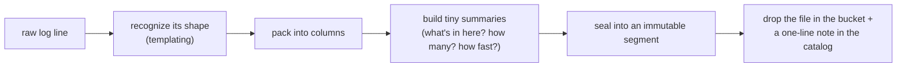
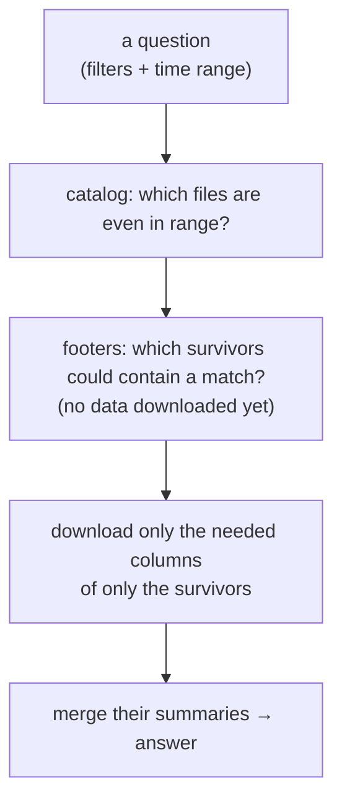

# How DataFocal works

A plain-English overview of the engine: the ideas behind it, then which package does each step.

---

## The problem, in a paragraph

Logs are the exhaust of running software: every service emits a continuous stream of them, and at real scale that's terabytes a month from thousands of services. Traditional logging tools make you run a big central pipeline that ingests, indexes, and stores all of it — and they bill you by how much you send. So the more you log, the more you pay, and the pipeline itself becomes the bottleneck and the cost center. We wanted the opposite: something cheap, with no central bottleneck, that's also genuinely good at *answering questions* — not just storing lines.

---

## The core bet: let object storage do the heavy lifting

Object storage — S3, GCS, Azure Blob, R2 — is cheap, effectively infinite, and extremely durable. Most logging systems treat it as a dumb backup: they keep the "real" data in a database or search cluster and use S3 only as cold storage behind it. That database is what you're really paying for.

**We flip it.** Object storage *is* the database. The log data and the index that makes it searchable both live as ordinary immutable files in your bucket. There is no separate database to run, scale, or pay for. This one decision drives everything else in the design: the collectors, compactor and querier share nothing but the bucket and a catalog.

---

## Three ideas that make that work

Storing everything as flat files in a bucket sounds like it should be slow and expensive to query. Three ideas keep it fast and cheap.

### 1. Index the data where it's born

Instead of shipping raw logs to a central place to be indexed, **each collector indexes its own logs as it writes them.** By the time a batch of logs lands in the bucket, it already carries its own index. Nothing central has to catch up. Adding more log sources adds more independent indexers — there's no shared component that gets overwhelmed.

### 2. The segment: a file that describes itself

The unit of storage is a **segment** — an immutable file that is *self-describing*. Alongside the compressed log data, each segment carries a small **footer**: a table of contents plus a statistical summary of what's inside.

Think of the footer as the blurb and index on the back of a book. Before you pull a book off the shelf, the blurb tells you whether it's even worth opening, and the index tells you which pages to turn to. A query reads a segment's footer — a tiny fraction of the file — and decides whether to open the segment at all, and if so, *which parts*.

### 3. Prune, don't scan

Because every file describes itself, answering a question is a **funnel that throws away almost everything before reading any real data**, rather than a scan that reads everything. At each stage the working set shrinks: from "all segments" to "segments in the right time range" to "segments that might contain a match" to "just the relevant columns of just the survivors." The bytes you actually download are proportional to what the question needs — not to how much you've logged.

---

## How a log line becomes a segment (the write path)

**Recognize its shape.** Most logs are the same handful of sentences with the blanks filled in differently. `Connection timeout to db-1` and `Connection timeout to db-7` are the same *template* — `Connection timeout to {host}` — with a different value. The collector masks the variable parts — every token containing a digit — so the same shape always gets the same id on every collector, and replaces messy text with a compact `(pattern, values)` pair. This is the quiet hero of the whole system: it turns high-entropy text into a few thousand repeating patterns, which makes everything downstream — compression, search, and AI — dramatically cheaper.

**Pack into columns.** Logs are stored column-by-column (all the timestamps together, all the templates together, all the hosts together) rather than line-by-line. Similar values sit next to each other, so they compress hard, and a query can read just the one column it cares about.

**Build tiny summaries.** As logs stream in, the collector cheaply maintains a few pocket-sized statistical structures per segment: which values are present, roughly how many unique things it saw, and the distribution of numbers like latency. These are the mergeable sketches that later let the query engine answer "how many?" and "what's the p95?" *without reopening the data.*

**Seal and note it.** When a segment reaches a size or age limit, it's frozen, written to the bucket as an immutable file, and a one-line **descriptor** is appended to the catalog. That descriptor — time range, labels, a pointer — is all the query engine needs to know the file exists. The collector never talks to a central server to do any of this.

---

## Where the files live (storage layout)

Segments are laid out in time-organized folders (`year/month/day/hour/...`), so a query for "the last hour" can rule out almost every folder just by its name.

Freshly written segments are small and numerous (good for capturing recent logs quickly). In the background — triggered by the writes themselves, never blocking them — a **compactor** merges small files into larger, tidier ones that are sorted and grouped for efficient scanning. It's the same tiered, log-structured layout a log-structured database uses, but the "database" is just files in a bucket.

The **catalog** ties it together: it's the card index that answers "which files could possibly matter for this query?" using only those one-line descriptors, so planning a query never requires opening a single data file. It's kept append-only and tidied up off to the side, so it's never a write bottleneck.

---

## How a question gets answered (the query path)

Three small structures in each footer power the pruning pipeline:

- **Signposts (zone maps):** the min and max value in each column. If a segment's timestamps run 14:00–14:05 and you asked about 15:00, skip it — without opening it.
- **A bouncer:** for needle-in-a-haystack lookups like a specific trace or user ID, a tiny filter can say "this ID is *definitely not* in this file." Most files get rejected at the door, so a specific lookup touches only the few files that could contain it.
- **Pocket summaries:** compact structures that answer "how many unique users?", "which errors are most frequent?", and "what's the p95 latency?" to within a small, known error — from the summary alone.

Here's the payoff of summarizing at write time: because every segment already carries these summaries, and because they're designed to **merge**, the query engine can answer aggregate questions across any span of time by *combining footers* — never reading the raw logs at all. And since footers are a tiny fraction of each file and read on nearly every query, they're kept hot in a memory/SSD cache, so most pruning happens with zero downloads. Reading actual log lines is reserved for when you truly need them: pulling up specific examples, or looking up one exact record.

---

## Which package does what: one log line, from a file to an agent

Each package does one step. Its API is one interface, per [STYLE.md](STYLE.md).

**Write path (the collector, one per node)**

1. **`ingest`** runs the collector process. It finds the configured sources, or discovers
   them: each **producer** source whose program is on `PATH`, such as the systemd journal
   or the syslog files and the log files under `/var/log`, but on a Kubernetes node only
   the commands and the container logs, leaving out the paths a producer source replaces. It passes
   each line through steps 2–4, the lines of different files parsed at once and collected
   in the order read, and saves how far it got in each source after every flush, so a
   restart resumes there. It stores nothing.
2. **`tail`** reads one file and returns each complete new line with its byte offset. It
   keeps reading across log rotation, and waits on filesystem notifications rather than
   polling, so an idle file costs nothing. It also follows a command that writes one JSON
   object per line, positioned by a cursor field.
3. **`logformat`** turns a raw line into a typed **record**. It strips the container
   runtime's wrapper, joins multi-line records such as stack traces, and reads the line in
   a **format**: a regexp's named groups, or a JSON or logfmt line's keys, some of which
   the format maps to canonical names such as `time`, `level`, `service` and `body`. A
   `body` is read again by auto, the rest of the record filling in what it lacks.
   - **`producers`** holds one JSON file per producer, such as `journald.json`,
     `syslog.json` and `klog.json`, with the formats and sources it adds, so supporting
     a new producer is a file and no Go.
     LLM model and usage aliases are discovered at ingest; a fixed query-time expression prices them.
   - **`identity`** names the record's `service` and `host` from the record and its file's
     path: its own `service`, which a format maps from a journal unit or a syslog tag, a
     Kubernetes pod's workload, or the file's directory.
4. **`collector`** buffers records and **seals** them into a segment when the batch is big
   or old enough, while the next batch fills, two batches at most, committing them in the
   order cut.
   - **`pattern`** gives each record its `pattern_id`, the line with every digit-bearing
     token masked.
   - **`segment`** holds the batch a column at a time as records arrive, and encodes it as
     columns plus a footer of summaries.
   - **`storage`** writes the bytes to the bucket.
   - **`catalog`** records one **descriptor** per segment, so a query finds segments
     without listing the bucket.

**Read path (the querier)**

5. **`api`** takes the agent's MCP or HTTP call and decodes it into a typed request.
6. **`tools`** has one method per tool. Each one plans, runs and shapes a response.
7. **`plan`** chooses what to read: descriptors, then footers, then row groups, skipping
   whatever cannot match.
8. **`summary`** and **`series`** answer from precomputed counts and footer summaries
   without reading rows. **`scan`** reads rows when the question needs them, such as a
   search or a trace.
9. **`stats`** holds the math that tools share: spike scoring, divergence, correlation.
10. **`querier`** builds the read path once at startup, and refreshes `summary` as new
    segments land.

### Which summary each column gets

Every field of every record is stored as a column, and every column can be filtered,
grouped, aggregated and searched. A summary only makes a query faster, by answering or
skipping a segment without reading rows. Each column's summary is chosen by its shape at
seal, never by its name:

| Column shape | Summary | Answers without reading rows |
|---|---|---|
| Every column | min/max and a distinct count | which segments can hold a value; "how many distinct" |
| Free text (values contain spaces) | a masked `<column>_pattern` copy | the copy is small, so it gets the next row |
| String, at most 1,024 distinct values in the segment | exact per-value counts | group-by, top values, explain-a-change |
| String, more distinct values, no spaces (ids) | a membership filter, outside the footer | "find this id": skip segments that cannot hold it |
| Number | a distribution | p50/p95/p99 |

`pattern_id` comes from `message` alone, so one log statement stays one pattern.

---

## Finding the story: correlation and insights

Storing and searching logs cheaply is table stakes. The point is to *explain* what's happening.

**Connecting related events.** When services pass along a shared trace ID, "show me everything for this request" is a single fast lookup. But the hard, real-world case is when there's *no* shared ID — the classic "why is my app slow?" where the true cause is several layers away in the infrastructure. The engine reconstructs the connection with statistical correlation three ways: **timing** (series that move together, and which one moves *first*, revealing cause vs. effect), **topology** (which service runs on which host, learned from the logs themselves), and **attribution** (breaking down a saturated resource by which service is actually responsible). Together these can walk from "user signups are failing" all the way down to "one batch job is hammering the disk on the host your database happens to share" — with no shared identifier anywhere in the chain.

**Surfacing what matters.** The system continuously learns what "normal" looks like for each log pattern and flags what deviates — a pattern spiking, a metric shifting, a sudden change in behavior. The strongest and cheapest signal of all is a **brand-new pattern**: a template the system has never seen before almost always means something changed. This is why the product can lead with "here's what's anomalous" instead of making you go looking.

---

## The AI layer (useful, not a chatbot bolted on)

Two principles keep the AI both effective and affordable:

**The math finds the signal; the AI narrates it.** Rather than pointing a language model at a firehose of logs and hoping, the engine does the heavy lifting with cheap statistics — it assembles a small, focused bundle of evidence (the new patterns, the anomalies, the correlated changes) and hands *only that* to the LLM to explain in plain language. The reasoning stays grounded in real computed evidence, and the token bill stays small.

**Agents get tools, not a search box.** AI agents interact through a typed set of operations — "aggregate this," "get this trace," "explain this spike" — the same operations that power the human UI. A structured, discoverable interface is something an agent can plan against reliably; a free-text search box is not. And because we only ever build semantic search over the few thousand *templates* (not every raw line), making the whole log estate searchable-by-meaning is cheap.

---

## Why it ends up cheap

Cost in traditional tools is driven by *volume*: everything gets shipped, re-ingested, and indexed by a central system you pay to run. Here, none of that happens. Collectors index in place; the "database" is just your bucket; and queries prune away almost everything before reading a byte. So the expensive middle tier simply isn't in the architecture. What's left is storage (cheap) and the compute for the queries you actually run.

